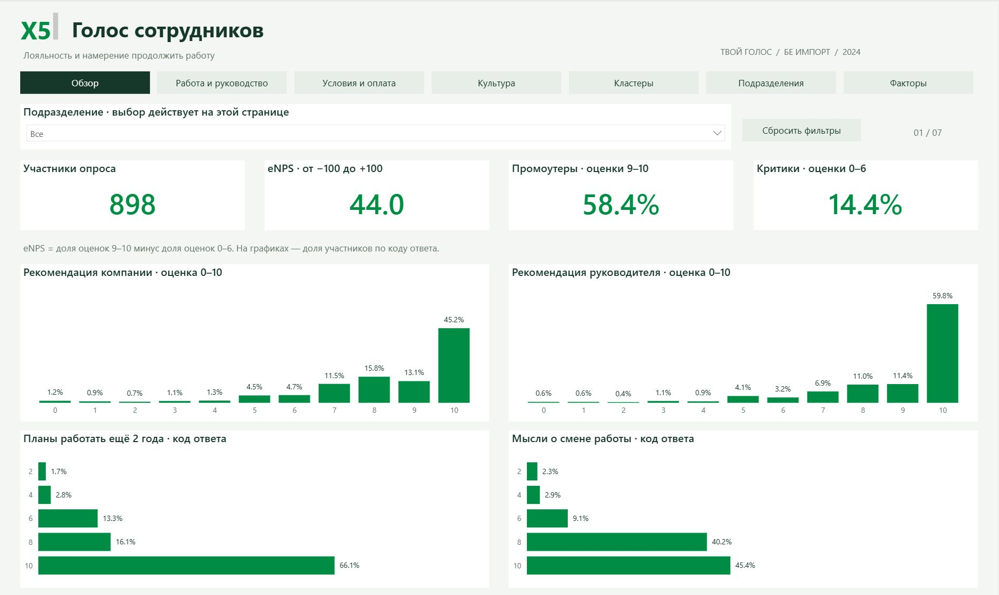
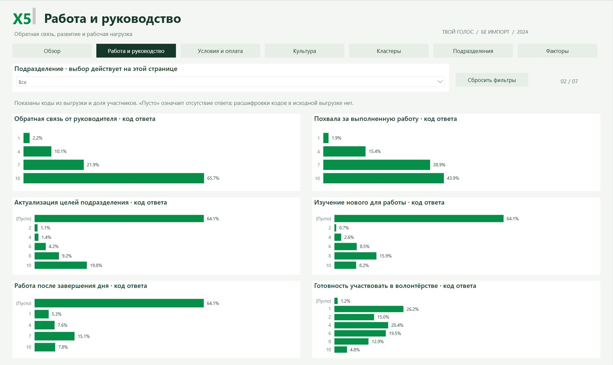

# X5 Group · Employee Survey Analytics

[← Danila Novikov · BI Portfolio](https://github.com/576e)

**Power BI · Survey Analysis · eNPS · Department Comparisons**

## Dashboard preview

### Overview

### Work and management

## Objective

Make employee survey results easier to explore: compare departments, examine perceptions of working conditions and management, and identify topics for further investigation.

## My Contribution

During my internship at Paper Planes, I contributed to a team project for X5 Group by creating visual breakdowns of metrics across categories. I independently developed a separate survey dashboard covering satisfaction across departments and the reasons behind ratings.

## Current Dashboard

| Page | Content |
| :--- | :--- |
| Overview | Respondent count, eNPS, promoter and detractor shares, and intention to stay |
| Work and management | Feedback, recognition, learning, and workload |
| Conditions and rewards | Ratings of pay, benefits, the workplace, and attitudes toward the company |
| Culture | Awareness of company values, mission, vision, and strategy |
| Clusters | Respondent distribution across clusters and their rating profiles |
| Departments | Comparisons across departments and respondent groups |
| Factors | Average ratings and variation in responses across attributes |

Hierarchical filters let users narrow the analysis to specific organizational units.

## Analytical Approach

- Combine summary metrics with response distributions to make differences between groups visible.
- Compare ratings across topics and departments within the selected filter context.
- Treat averages and variation as descriptive statistics. Differences in a chart alone do not establish statistical significance or causation.

## Outcome

Survey results organized into seven thematic pages with consistent navigation and filters. The report helps explore differences in employee perceptions and frame questions for deeper analysis.

## Open the dashboard

Download [the Power BI report](dashboard/X5-Employee-Survey.pbix) and open it in Power BI Desktop. The PBIX includes the saved data model, so you can explore the existing snapshot without refreshing. Data refresh requires access to the original sources and may require updating source paths.

The report is presented as a portfolio project. It is not an official product of the named organization.

